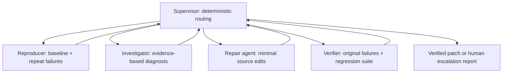

# ProofPatch

**AI that must show its work before calling a fix verified.**

ProofPatch is a Week 1 prototype for repairing small Python repositories with failing
pytest tests. A LangGraph supervisor routes work through a reproducer, investigator,
repair agent, and deterministic verifier. It produces a reviewable patch and evidence
bundle while leaving the input repository untouched.

> Status: Week 1 implementation. The bundled demo uses scripted agent responses and
> real pytest execution. It demonstrates the reliability pipeline, **not** an LLM repair
> success rate. The OpenAI provider is implemented; live model quality requires a separate
> credentialed run. Docker, MCP, GitHub failure ingestion, and a dashboard are later milestones.

## Try it

Python 3.11–3.13 on Linux or macOS:

```bash
python -m venv .venv
source .venv/bin/activate
python -m pip install -c requirements.lock -e '.[dev]'
proofpatch examples/buggy_stats --provider demo --trusted-local
```

The demo starts with **5 failed / 4 passed** tests across three seeded bugs. It reproduces
the five failures, proposes a source-only patch, then requires **5/5 focused tests** and
**9/9 regression tests** to pass. Each invocation creates a fresh `artifacts/<id>/` folder.

```text
ProofPatch — VERIFIED
Reproduced failures passed; selected regression suite retained all tests.
Report: .../artifacts/<id>/report.md
```

Read `report.md`, inspect `verified.patch`, and open the stage logs and JSON evidence.
The deliberately broken example stays broken so the demonstration can be repeated.

## Live investigation and repair

Install the target project's dependencies in the same environment first. Use an explicit
model ID supported by your OpenAI account and structured outputs:

```bash
export OPENAI_API_KEY='your-key'  # Prefer your secret manager; never commit a key.
proofpatch /path/to/trusted/python-project \
  --provider openai --model YOUR_MODEL_ID \
  --tests tests --trusted-local --output /path/outside/project/incident-001
```

Live mode sends Python source, Python tests, and failure log excerpts to OpenAI. Review
the repository for sensitive content first. `.env`, key files, common build folders, and
hidden directories are excluded from the copied workspace. This is not a comprehensive
secret scanner. API credentials are excluded from the test subprocess environment.

The investigator returns a structured diagnosis. A separate repair call receives that
diagnosis, source, and evidence, and returns exact-match edits. Only pytest results can
set the incident to `verified`; a model cannot set that status.

## Architecture



The supervisor, reproducer, and verifier are deterministic nodes. The investigator and
repair agent have distinct model roles. This intentionally avoids five redundant LLM calls.
Unsuccessful verification can route back to repair, with concrete failure feedback and a
fresh copy of the original source; at most two repair attempts are allowed.

## What “verified” means

All of the following must hold:

1. The selected baseline suite actually executes and contains failing test calls.
2. The same failing node IDs fail again before any patch is applied.
3. Every originally failing test passes after the patch (a skip does not count).
4. The selected full regression suite exits cleanly and retains exactly the same test IDs.
5. Every originally passed or failed test passes; previously skipped tests may remain skipped.
6. Tests, configuration, and other protected files are unchanged; test execution did not
   mutate the copied repository.

Collection errors, missing evidence, empty suites, flaky reproduction, timeouts, provider
errors, invalid patches, and exhausted attempts escalate. “Verified” is scoped to the
selected tests and environment; it is not a proof of general correctness.

## Evidence bundle

| File | Purpose |
| --- | --- |
| `report.md` / `report.json` | Decision, reason, diagnosis, test identities, source hashes, usage |
| `trace.jsonl` | Every agent transition, timestamp, duration, and error |
| `baseline.*` / `reproduction.*` | Before-patch test outcomes and logs |
| `proposal-N.json` / `attempt-N.patch` | Rationale, exact edits, proposed diff for every attempt |
| `attempt-N-focused.*` / `attempt-N-regression.*` | After-patch outcomes and logs |
| `verified.patch` | Created only after all verification gates pass |

Existing evidence directories are never overwritten. Exit codes: `0` verified, `1`
escalated, `2` invalid CLI/configuration. Proposed patches are never automatically applied
to your original checkout, committed, pushed, or submitted as pull requests.

## Run the checks

```bash
ruff check .
ruff format --check .
pytest -q
python scripts/check_demo.py --output artifacts/ci-demo
python scripts/check_escalation.py --output artifacts/ci-escalation
```

GitHub Actions runs these checks on Python 3.11, 3.12, and 3.13, then uploads the actual
demo evidence as a workflow artifact. No API key is needed for CI. See
[the Week 1 acceptance checklist](docs/week-1.md) for scope and limitations.

## Boundaries and roadmap

**Week 1 is trusted-local execution only.** A disposable directory and a subprocess are
not a sandbox. Target tests and proposed Python patches execute with your OS permissions;
do not run this prototype on unknown repositories. The local runner is POSIX-only, has a
per-command timeout, kills its process group on timeout, and disables automatic pytest
plugin loading. Projects requiring external pytest plugins, editable package installation,
services, or special environment variables need further runner support.

The prototype caps live calls at 12, output tokens at 4,096 per call, repair attempts at 2,
and model input context at 100 KB. API errors escalate immediately (SDK retries disabled).
Token usage is recorded, but **the $0.50 budget cap is not yet implemented** and no dollar
cost is inferred. Do not treat call limits as a spending guarantee.

- Week 2: restricted Docker execution, MCP tools, GitHub Actions failure ingestion.
- Week 3: priced budget reservations, transient retries, persistence/recovery, approval
  gates for PR creation, MLflow tracing, and broader failure injection.
- Week 4: 30+ unseen seeded cases, single-agent baseline comparison, dashboard, demo video,
  and an honest evaluation report. No 70% repair-rate claim is made today.

## Implementation references

- [LangGraph graph API](https://docs.langchain.com/oss/python/langgraph/graph-api)
- [OpenAI structured outputs](https://developers.openai.com/api/docs/guides/structured-outputs)
