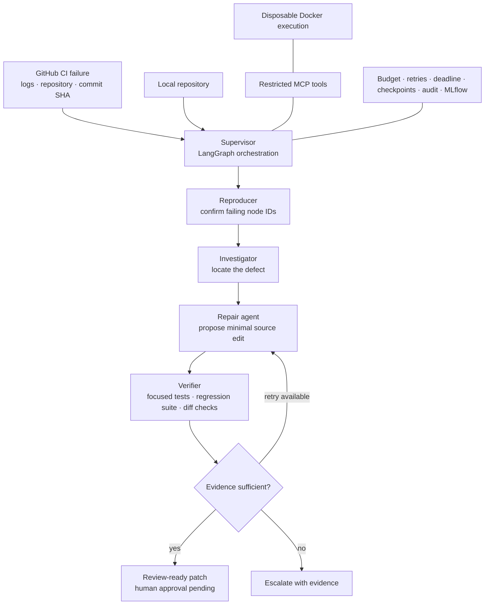

# ProofPatch

[](https://github.com/Aahil19/ProofPatch/actions/workflows/ci.yml)
[](https://github.com/Aahil19/ProofPatch/actions/workflows/benchmark.yml)
[](https://aahil19.github.io/ProofPatch/)

**An evidence-driven multi-agent system for debugging and repairing Python test failures.**

ProofPatch routes an incident through a supervisor, reproducer, investigator, repair agent,
and deterministic verifier. It cannot label a patch verified unless the original failure is
reproduced, the formerly failing tests pass, and the selected regression suite retains every
test identity. Uncertain incidents stop with an evidence bundle for a human reviewer.

[Explore the evaluation dashboard](https://aahil19.github.io/ProofPatch/) ·
[Watch the 12-second evidence trace](docs/proofpatch-demo.mp4) ·
[Read the evaluation report](docs/evaluation.md) ·
[Run an investigation on GitHub](https://github.com/Aahil19/ProofPatch/actions/workflows/investigate.yml)

## Measured results

The committed benchmark contains 30 deterministic, single-fault scenarios across three
small Python repositories. Every score comes from real pytest executions.

| System | Verified | Escalated | Verified rate | Reproduction coverage | False verified |
| --- | ---: | ---: | ---: | ---: | ---: |
| ProofPatch supervisor | 27 / 30 | 3 | **90%** | 100% | 0 |
| Single-attempt baseline | 21 / 30 | 9 | 70% | — | 0 |

The repair candidates are scripted fixtures. This benchmark isolates the effect of
reproduction, verification feedback, a bounded second attempt, and safe escalation; it is
**not** a language-model repair-accuracy claim. Both evaluated systems have $0 LLM cost.
See [methodology, per-case results, and limitations](docs/evaluation.md).

```bash
python scripts/run_benchmark.py --output benchmarks/results.json
```

## How an incident moves through the system



The graph executes **reproduce → investigate → repair → verify**. Supervisor decisions are
explicit LangGraph transitions. Reproduction and verification are deterministic; only the
investigator and repair roles use the selected provider. An unsuccessful candidate is never
stacked onto the next one: each attempt starts from the exact failing snapshot.

## Run it locally

Python 3.11–3.13 on Linux or macOS:

```bash
python -m venv .venv
source .venv/bin/activate
python -m pip install -c requirements.lock -e '.[dev]'
proofpatch examples/buggy_stats --provider demo --trusted-local
```

The bundled fixture begins with five failing and four passing tests. The scripted provider
proposes a three-defect source patch; ProofPatch then requires all five focused tests and all
nine regression tests to pass. The input checkout remains unchanged and a fresh
`artifacts/<incident>/` evidence directory is created.

For Docker-isolated execution through the MCP boundary:

```bash
docker build -t proofpatch-runner:0.2 docker
proofpatch examples/buggy_stats --provider demo --execution docker
```

## Investigate a GitHub Actions failure

Open [Investigate GitHub failure](https://github.com/Aahil19/ProofPatch/actions/workflows/investigate.yml),
choose **Run workflow**, and paste a completed failed Actions run URL. Demo mode needs no
secret. Live mode requires an `OPENAI_API_KEY` Actions secret, an explicit model ID, and the
model's current input/output prices so the budget control can reserve real dollars.

From a machine with Docker running:

```bash
proofpatch https://github.com/OWNER/REPO/actions/runs/RUN_ID \
  --provider openai --model YOUR_MODEL_ID \
  --input-price-per-million INPUT_USD \
  --output-price-per-million OUTPUT_USD \
  --subdir .
```

URL investigations use **MCP → Docker** without a host-execution fallback. ProofPatch pins
the recorded commit and workflow attempt, retrieves failed-job logs, and requires locally
reproduced pytest failures to match IDs found in the CI evidence. The restricted MCP server
exposes only `get_ci_logs`, `read_file`, `run_tests`, and `get_diff`.

A complete public example is available in the
[guarded investigation run](https://github.com/Aahil19/ProofPatch/actions/runs/38831728400).
It records five reproduced failures, five focused passes, nine regression passes, and a
review-ready patch with approval still pending.

## Evidence contract

“Verified” means all of the following are true:

1. The selected baseline suite executed and contained a failing test call.
2. The same failing node IDs failed again before any source edit.
3. Every formerly failing test passed after the candidate patch; skips do not count.
4. The selected regression suite exited cleanly with exactly the same test identities.
5. Tests, configuration, and protected files were unchanged.
6. Test execution did not mutate the copied repository.

Collection errors, flaky reproduction, missing evidence, timeouts, malformed provider output,
invalid patches, exhausted attempts, and budget failures all escalate. Verification is scoped
to the selected tests and execution environment; it is not a proof of general correctness.

## Guardrails and observability

- **Cost:** $0.50 default incident cap with pre-call reservations and operator-supplied rates.
- **Loops:** 12 model calls, two repair attempts, and 4,096 output tokens per call at most.
- **Failures:** two transient retries with exponential backoff and a 600-second incident deadline.
- **Recovery:** SQLite checkpoints resume interrupted graph stages without repeating completed work.
- **Approval:** a verified patch remains pending until an explicit reviewer decision creates `approved.patch`.
- **Isolation:** GitHub URL runs execute as a non-root user in a network-disabled disposable container.
- **Audit:** JSONL transitions, tool calls, duration, token/cost data, plus optional MLflow spans.
- **Failure injection:** CI exercises budget exhaustion, MCP unavailability, and deadline handling.

See [reliability controls](docs/reliability.md), [integration boundaries](docs/integrations.md),
and [the evidence model](docs/evidence-model.md).

## Evidence bundle

| File | Purpose |
| --- | --- |
| `report.md` / `report.json` | Decision, reason, diagnosis, provenance, test IDs, usage, approval state |
| `trace.jsonl` | Every graph transition, duration, route, and error |
| `baseline.*` / `reproduction.*` | Before-patch outcomes and logs |
| `proposal-N.json` / `attempt-N.patch` | Every repair rationale, exact edit, and diff |
| `attempt-N-focused.*` | Outcomes for the formerly failing test IDs |
| `attempt-N-regression.*` | Outcomes for the selected full suite |
| `verified.patch` | Created only after every evidence gate passes |
| `approved.patch` / `approval-events.jsonl` | Created only by the explicit review gate |
| `llm-calls.jsonl` / `mcp-tools.jsonl` / `mlruns/` | Model, tool, cost, and trace telemetry |

ProofPatch never modifies the input checkout, opens a pull request, or merges a patch. Existing
evidence directories are not overwritten except through validated checkpoint resume.

## Development

```bash
ruff check .
ruff format --check .
pytest -q
python scripts/check_demo.py --output artifacts/ci-demo
python scripts/check_escalation.py --output artifacts/ci-escalation
python scripts/check_guardrails.py
python scripts/run_benchmark.py --output artifacts/benchmark-results.json
```

GitHub Actions runs the core suite on Python 3.11, 3.12, and 3.13, executes real Docker/MCP
integration checks, injects guardrail failures, runs all 30 benchmark incidents, and publishes
the dashboard to GitHub Pages. Full per-incident evidence is uploaded as a workflow artifact.

## Security boundary

Trusted-local mode launches a subprocess with your operating-system permissions. Use it only
for reviewed repositories. GitHub URL and `--execution docker` runs use a read-only source
mount, no network, a non-root user, dropped capabilities, `no-new-privileges`, and CPU,
memory, process, and temporary-filesystem limits. Containers reduce exposure but are not a
complete defense against hostile code or a compromised Docker host; use a disposable runner
for untrusted repositories.

The default container intentionally contains only Python and pytest. Projects that need extra
dependencies require a reviewed custom image. Live mode sends selected Python source, tests,
and failure-log excerpts to the configured model provider after excluding common key files,
hidden directories, and build outputs; this is not a comprehensive secret scanner.

## Documentation

- [Architecture and trust boundaries](docs/architecture.md)
- [Evidence model and acceptance criteria](docs/evidence-model.md)
- [GitHub, MCP, and Docker integrations](docs/integrations.md)
- [Guardrails, recovery, approval, and tracing](docs/reliability.md)
- [Benchmark methodology and findings](docs/evaluation.md)

## Implementation references

- [LangGraph graph API](https://docs.langchain.com/oss/python/langgraph/graph-api)
- [OpenAI structured outputs](https://developers.openai.com/api/docs/guides/structured-outputs)
